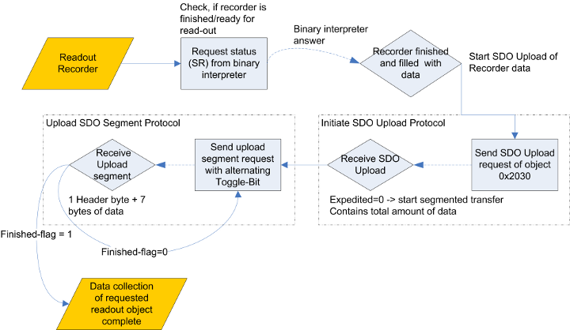

## Elmo Recorder

### General     overview, workflow

Elmo controllers have the functionality to record drive information
(like position,velocity, current) at a very high frequency into their
own flash memory. Later on, you can read out the recorded data and
analyze it on a (remote) PC. Read-out can easily be done by connecting
the computer over RS-232 directly to the Elmo-MC.

Another way, that realizes a much easier way of reading out multiple
Elmo MCs at once, is to do this via CANopen protocol using the CAN-bus,
that is described in the following.

The package cob_canopen_motor contains an implementation for Elmo
Harmonica drives. The integrated class !ElmoRec provides functions to
give the user easy access to the recording functionalities of these
drives.This class performs all necessary steps to configure the recorder
and to read out and process the data.\
These steps to get drive information from the Recorder are described in
the following chapters.

In order to get data, you have to perform the following steps:

1\. Configure the recorder using binary interpreter commands. You have
to set properties such as recording length, which data should be
recorded, start-trigger\... 1. Start the recorder if not done
automatically by a preset trigger 1. Read-out data, after recording is
finished 1. Request one specific recorded channel via SDO Request 1.
Performing a "segmented SDO Upload"

### Configure   the recorder

You can find a lot information about advanced functions and
configuration options on the Elmo MC website
(<http://www.elmomc.com/products/whistle-digital-servo-drive-main.htm>).

In the following, one example configuration of the recorder is given:\
(See also __SimplIQ Software Manual__, 7.4 The Recorder).


```
//Stop Recorder if it's active
RR = -1
```

 

```
// Record:
// Main speed (index 0, ID1)
// Main Position (index 1, ID2)
// Active Current (index 9, ID10)
// Speed Command (index 15, ID16)
// RC = 2^(Signal1 Index)  + 2^(Signal2 Index) + ... e.g. 2^0 + 2^1 + 2^9  + 2^15 = 33283
RC = 33283
```


```
// Set Recording Length
// RL = (4096 / Number of recorded signals) as Elmo MC can store 4096 data points
RL = 1024
```

 

```
// Set Time Quantum, Default: RP=0 -> Time Quantum = TS * 4; TS is 90us by default
RR = 0
```


```
// Set Recording Gap
// Recording Gap specifies, every which Time Quanta a data point is recorded
RG = 1
```

 

```
// -> Total Recording Time = 90us * 4 * RG * RL
```

 That all was the very
basic configuration of the recorder. Next, you can specify various
trigger events or optionally start the recorder immediately.


```
// Set trigger type to immediate and start recording
RR = 2
```

 

```
//or start at next BH-command
RR = 1
```

 Now you have to wait
until recording of data has finished. To request the recorder state, use
the general status register (binary interpreter SR), that contains 2
bits (bit 16 - 17) telling the recorder state (0: Recorder inactive, no
valid recorded data , 1: Recorder waiting for a trigger event , 2:
Recorder finished; valid data ready for use , 3: Recording now) When the
recorder has finished, you can start the read-out process.

### Read        out recorder via CAN

In this document, only the read-out via CAN is described. For
information about how to get data via RS-232, please refer to
__SimplIQ Command Reference.__

You can get the recorded data using a !ServiceDataObject (SDO). SDOs are
part of the CANopen protocol and are documented properly in the
__CANopen DS 301 Implementation Guide__ by Elmo.

You have to initiate a (segmented) SDO Upload (upload means from Elmo MC
to computer) according to the CANopen protocol (see 4.3f in __CANopen
DS 301 Implementation Guide__). Each received segment must be answered
by a message including a toggle-bit. Every segment has one header byte
for managing SDO transfer (including toggle-bit, last-segment-bit and
number of unused bytes). The other 7 bytes are actual data.

Recorded data is stored in SDO object 0x2030, the subindex specifies
which signal should be uploaded. You can only upload signals, that have
been explicitly selected for recording earlier.

After starting the SDO transfer you get a data stream of the values of
the selected signal.

Consider, that all the data you get is "Little Endian" formatted. That
means, the least significant byte of a value stands first in the stream.
The first 7 bytes of the emitted stream contain header information:

  -- ----------------------------------------- -- ------------------------------------------------------------- -- ------------------------------------------------------------------------------- -- -------------------------------------------------------------------------------------------- --
                                                                                                                                                                                                      <tablewidth="100%"style="text-align: center;">**Header byte of emitted data stream**   

                                                  <33% height="19px" style="text-align: center;">Byte 1      <33%>Byte 2 - 3                                                                  <33%>Byte 4 - 7                                                                            

     <18% height="20px">4 Bit *Int*           <15%>4 Bit *Int*                                               <33%>*Integer*                                                                   <33%>*Float*                                                                               

     <18% height="67px">Type of values:\      <15%>DeltaT between data points in N \* TS(90µsec)             <33%>Number of recorded data points = number of data items (á 4 or 2 bytes)      <33%>Factor, which every data value has to be multiplied with                              
     4 = 32bit Int\                                                                                                                                                                                                                                                                                
     1 = 16bit Float\                                                                                                                                                                                                                                                                              
     5 = 32bit Float                                                                                                                                                                                                                                                                               
  -- ----------------------------------------- -- ------------------------------------------------------------- -- ------------------------------------------------------------------------------- -- -------------------------------------------------------------------------------------------- --

*Remember always to apply "Little Endian" conversion byte-wise.*

Float values are given in IEEE 754 representation and have to be
converted (see <http://en.wikipedia.org/wiki/IEEE_754-1985>).

### Flowchart of read-out process



[(show graph)](doc/SDO_Readout_Elmo_Recorder.png)
