## Mimic modes

  -- ---------------- -- ------------------------------------------ -- -- -- ---------------- -- ------------------------------------------ --
     afraid              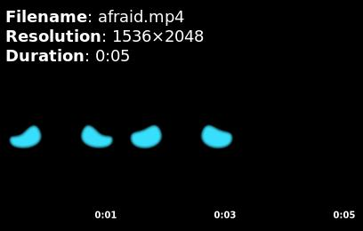                    angry               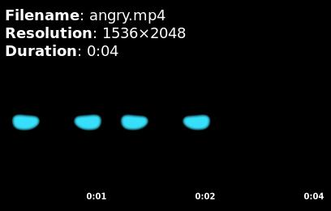            
     asking              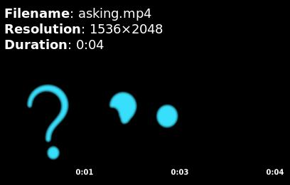                    blinking            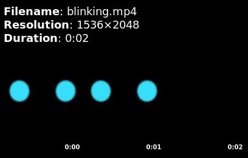         
     blinking_left       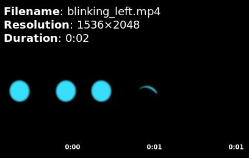             blinking_right      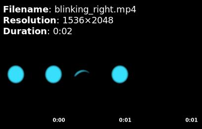   
     bored               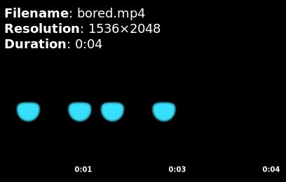                     busy                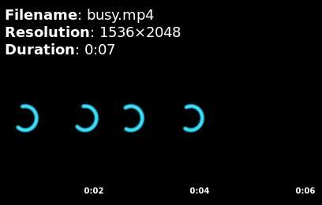             
     confused            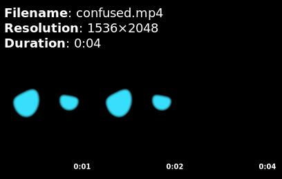                  default             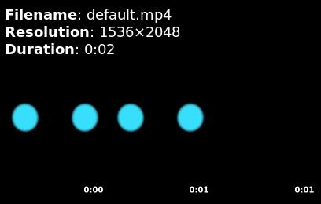          
     falling_asleep      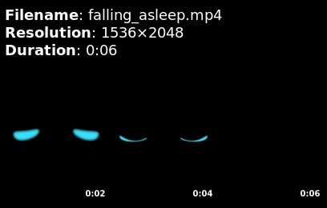            happy               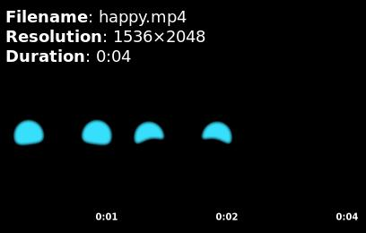            
     laughing            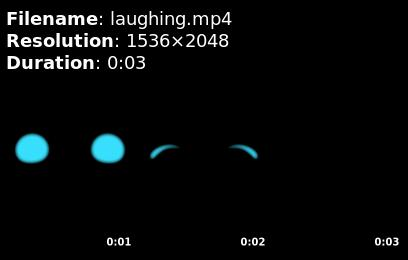                  no                  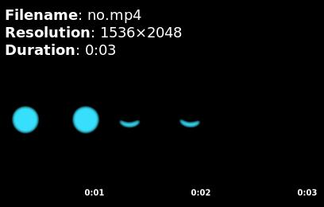               
     sad                 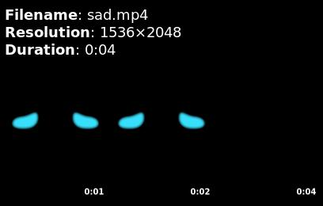                       searching           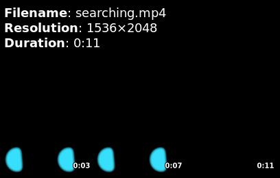        
     sleeping            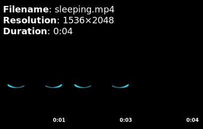                  surprised           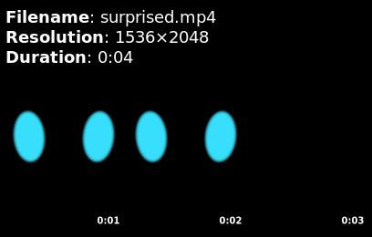        
     tired               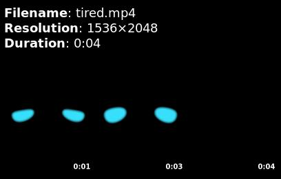                     waking_up           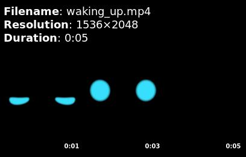        
     yes                 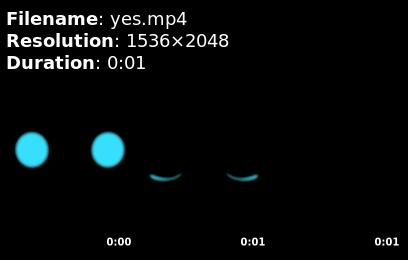                                                                                      
  -- ---------------- -- ------------------------------------------ -- -- -- ---------------- -- ------------------------------------------ --
